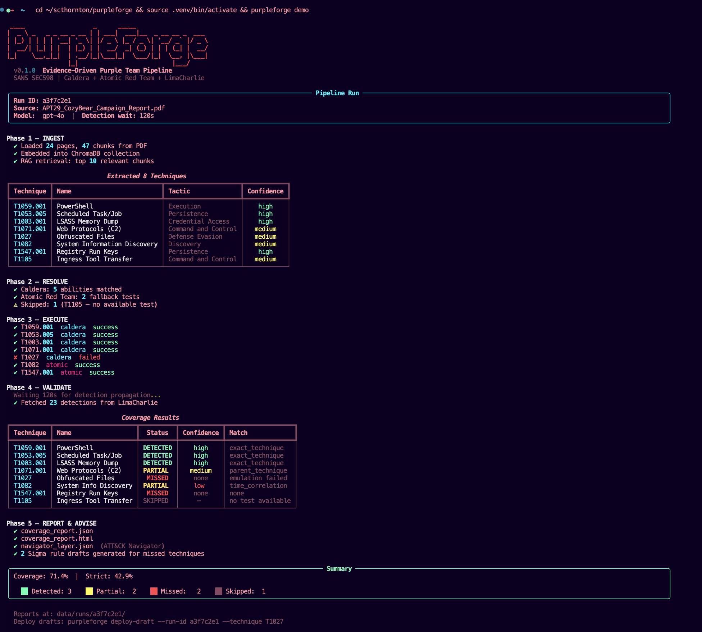

# PurpleForge

Evidence-driven purple team pipeline for SANS SEC598.

Given a threat report, PurpleForge extracts ATT&CK techniques, executes adversary emulations (Caldera + Atomic Red Team), validates detections (LimaCharlie), and produces a trustworthy coverage report with per-technique proof chains.

<p align="center">
  
</p>

## Background

Purple teaming bridges the gap between red team emulation and blue team detection. The challenge is proving coverage claims — "we detect T1059.001" is meaningless without evidence. PurpleForge solves this with a deterministic pipeline that produces auditable, evidence-rich coverage reports.

Every "detected" or "missed" claim is backed by a complete evidence chain: emulation step IDs, timestamps, telemetry query windows, matching alert IDs, and confidence levels.

The pipeline uses a state machine (not AI agents) because the workflow is fixed: extract → resolve → execute → validate → report. AI adds value for novel reasoning; technique mapping is a lookup, not a judgment call.

## Architecture

```
purpleforge run --source report.pdf
  │
  ├─ INGEST     PDF → chunk → LLM extract TTPs (map-reduce over the report)
  ├─ REVIEW     Human gate — operator reviews extracted_ttps.yaml
  │
purpleforge confirm --run-id <id>
  │
  ├─ RESOLVE    Technique → Caldera ability? → Atomic fallback? → Skip
  ├─ EXECUTE    Caldera operations + Atomic Red Team via WinRM
  ├─ WAIT       Detection propagation delay (default 120s)
  ├─ VALIDATE   Query LimaCharlie → build evidence chains per technique
  ├─ REPORT     JSON + HTML + ATT&CK Navigator layer
  └─ ADVISE     Sigma rule drafts for missed techniques (optional)
```

## Repository Layout

```
src/purpleforge/
  cli.py                    Click CLI: run, confirm, status, report, deploy-draft, list, demo
  config.py                 Pydantic Settings — all env vars with SecretStr
  models/                   Pydantic data models (extraction, emulation, evidence, advisory, pipeline)
  ingest/                   PDF loading, chunking, LLM TTP extraction
  resolve/                  Caldera-first, Atomic fallback technique resolution
  execute/                  Caldera operation executor, Atomic WinRM executor
  validate/                 LimaCharlie detection querying, evidence chain builder
  report/                   Coverage analyzer, ATT&CK Navigator heatmap, HTML report, advisory generator
  clients/                  REST API clients (Caldera, LimaCharlie, Atomic WinRM, GitHub)
  pipeline/                 State machine orchestrator, file-based run store
  templates/                Self-contained HTML coverage report template (dark theme, inline CSS)

tests/
  unit/                     116 unit tests with mocked external services
  fixtures/                 Sample PDF, pre-extracted TTPs, mock API responses
```

## Quick Start

**1. Install:**

```bash
pip install -e ".[dev]"
cp .env.example .env
# Edit .env with your API keys (see .env.example for all variables)
```

**2. Ingest a threat report:**

```bash
purpleforge run --source ~/reports/apt29_report.pdf
```

**3. Review extracted TTPs:**

Open `data/runs/<run-id>/extracted_ttps.yaml`, edit as needed.

**4. Confirm and execute the full pipeline:**

```bash
purpleforge confirm --run-id <id>
```

**5. View results:**

```bash
purpleforge status --run-id <id>
# Reports at: data/runs/<id>/coverage_report.html
#              data/runs/<id>/navigator_layer.json
```

**6. Deploy advisory drafts (optional):**

```bash
purpleforge deploy-draft --run-id <id> --technique T1027 --target stdout
purpleforge deploy-draft --run-id <id> --technique T1027 --target github
```

## Requirements

- Python 3.11+
- [Caldera](https://caldera.mitre.org/) server (adversary emulation)
- [LimaCharlie](https://limacharlie.io/) organization (detection backend)
- Windows host with WinRM enabled (Atomic Red Team target)
- OpenAI API key (TTP extraction and advisory generation)
- GitHub token (optional — only for `deploy-draft --target github`)

## CLI Commands

| Command | Description |
|---------|-------------|
| `purpleforge run` | Ingest threat report PDF, extract TTPs, pause for human review |
| `purpleforge confirm` | Confirm TTPs and execute full pipeline (resolve → execute → validate → report) |
| `purpleforge status` | Show current pipeline state and step history |
| `purpleforge list` | List all pipeline runs |
| `purpleforge report` | Regenerate reports from existing evidence data |
| `purpleforge deploy-draft` | Deploy an advisory Sigma rule draft (stdout or GitHub PR) |
| `purpleforge demo` | Show a sample pipeline run with realistic output |

## Evidence Model

The core data structure is the `EvidenceChain` — one per emulated technique:

| Field | Description |
|-------|-------------|
| `technique_id` | ATT&CK technique (e.g., T1059.001) |
| `emulation_step_id` | Caldera operation link ID or WinRM session ID |
| `execution_timestamp` | When emulation started |
| `detection_query_window` | Time range searched for detections |
| `matching_alerts` | LimaCharlie alert IDs, rule names, tags |
| `best_match_type` | exact_technique, parent_technique, time_correlation, none |
| `confidence` | high, medium, low, none |
| `status` | detected, partial, missed |

Coverage is reported two ways:
- **Lenient**: (detected + partial) / (total - skipped)
- **Strict**: detected / (total - skipped)

## Design Principles

**The product is the evidence-rich coverage report, not the breadth of integrations.** One detection backend (LimaCharlie), proven end-to-end, is more valuable than three backends with untested integrations.

**Human gate before execution.** Extracted TTPs are written to YAML for operator review before any emulation runs. This prevents upstream extraction errors from becoming expensive emulation mistakes.

**Every claim has a proof chain.** A coverage report that says "detected" without linking to a specific alert ID, timestamp, and matching rule is untrustworthy. PurpleForge makes this impossible.

**Advisory rules are drafts, never auto-deployed.** AI-generated Sigma rules are stored as advisory drafts with confidence scores, explanations, and limitation notes. The `auto_deployed` field is typed as `Literal[False]` — it cannot be set to `True`.

**Crash-safe state management.** Run state is stored as YAML files with atomic writes (write to `.tmp`, then rename). Partial failures can be resumed from the last completed step.

## Development

```bash
pip install -e ".[dev]"
make all       # lint + typecheck + test
make test      # pytest with coverage
make lint      # ruff check
```

116 tests covering all models, clients (mocked HTTP), resolver, validator, coverage analyzer, and heatmap generator.

## Contributing

1. Create a feature branch from `main`
2. Implement changes with tests
3. Run `make all` to verify lint + typecheck + tests pass
4. Submit a PR with a clear description

## Important Notes

- This tool is designed for **authorized lab environments only**. It executes adversary techniques on target systems.
- All credentials use `SecretStr` — they never appear in logs or CLI output.
- Caldera operations are idempotent — operations are named with the run ID and checked before creation.
- Raw emulation output is truncated to 5,000 characters to prevent sensitive data in reports.
- The ML extraction uses OpenAI's structured output API — invalid technique IDs are rejected at the Pydantic validation layer.

---

## Contact

**Scott Thornton** — AI Security Researcher

- Website: [perfecxion.ai](https://perfecxion.ai/)
- Email: [scott@perfecxion.ai](mailto:scott@perfecxion.ai)
- LinkedIn: [linkedin.com/in/scthornton](https://www.linkedin.com/in/scthornton)
- ORCID: [0009-0008-0491-0032](https://orcid.org/0009-0008-0491-0032)
- GitHub: [@scthornton](https://github.com/scthornton)

**Security Issues**: Please report via [SECURITY.md](SECURITY.md)
